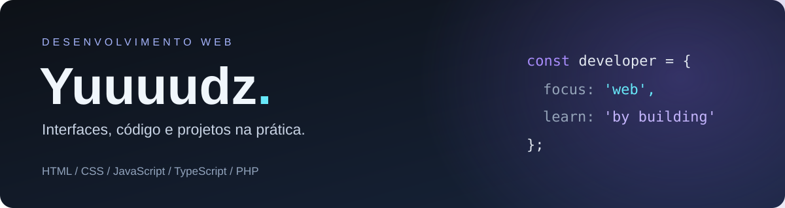

  

 

<h2 align="center">Languages</h2>

  

 

<h2 align="center">Tools</h2>

  

 

<h2 align="center">My websites</h2>

  
  &nbsp;
  
  &nbsp;
  

 

<h2 align="center">Other projects</h2>

  <a href="https://github.com/Yuuuudz/HabitFlow"><b>HabitFlow</b></a> — a browser-based habit tracker.
    
  <a href="https://github.com/Yuuuudz/blackfridaygames"><b>BlackFridayGames</b></a> — a game deals website built with PHP.

